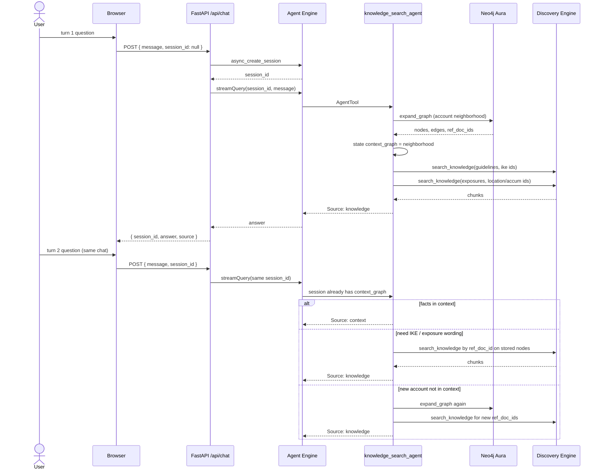

# Graph RAG chat retrieval

How FastAPI, Neo4j, the knowledge search agent, session context, and Vertex AI Search (Discovery Engine) work together for the underwriting desk.

The graph holds **neighborhood + ref doc ids**. Discovery Engine holds **IKE and exposure text**. FastAPI is the chat gateway that keeps one `session_id` so that neighborhood stays loaded across turns. Types and allowed edges: [ontology/README.md](../ontology/README.md).

**All underwriting figures are fictional.**

---

## FastAPI and the Neo4j connection

FastAPI (`backend/main.py`, Cloud Run `uw-chat-api`) does **not** open Bolt itself. It cannot share a driver with Agent Engine: they are different processes. What it *does* establish is the **session** in which the knowledge agent is allowed to open Neo4j and write `context_graph`.

```
Browser
  POST /api/chat  { message, session_id?, user_id }
        │
        ▼
FastAPI  (Cloud Run)
  • if session_id is missing: Agent Engine async_create_session
  • every turn: Agent Engine async_stream_query(user_id, session_id, message)
        │
        ▼
Agent Engine  (ADK, same session_id)
  knowledge_search_agent tools run here
  NEO4J_URI / NEO4J_USER / NEO4J_PASSWORD  →  Aura or local Bolt
        │
        ▼
Neo4j  (Aura neo4j+s://…  or  bolt://127.0.0.1:7687)
```

| Piece | Role |
|---|---|
| FastAPI | HTTP API, CORS, create/reuse `session_id`, return `{ answer, source, session_id }` |
| Agent Engine | Runs `underwriting_root` → `knowledge_search_agent` |
| Neo4j driver | Opened inside `uw_chat/neo4j_store.py` when `expand_graph` runs |
| Session state | Key `context_graph` on that `session_id` (neighborhood + ref doc ids) |

Env on the **Agent Engine** runtime (not on Cloud Run, unless you run ADK inside FastAPI locally):

```bash
NEO4J_URI=neo4j+s://XXXX.databases.neo4j.io   # Aura; local: bolt://127.0.0.1:7687
NEO4J_USER=neo4j
NEO4J_PASSWORD=…
```

`uw_chat/neo4j_store.py` probes Bolt, then `GraphDatabase.driver(URI, auth=(USER, PASSWORD))`. If Bolt is down, `expand_graph` falls back to `uw_chat/graph.json` so chat still works.

The browser keeps `session_id` from the first FastAPI response and sends it on every later `POST /api/chat`. That is how Neo4j-derived context survives turn two.

---

## Turn 1 — graph traversal, load context on the knowledge agent

User: *Can we write Texwin Acquisitions for the Houston warehouse?*

FastAPI forwards that string on a new (or empty) session. The root calls **`knowledge_search_agent`**. That agent does not search Vertex first. It walks the graph, then stores the neighborhood on the session.

```
knowledge_search_agent
  1. expand_graph(user question)
       • link names in the question → Account / Location / …
       • Cypher: full account neighborhood (schema-aware, not blind [*] hops)
       • each node carries ref_doc_id + datastore
  2. remember_expansion → session state["context_graph"]
  3. search_knowledge(guidelines | exposures, ids=ref_doc_ids)
       • Discovery Engine chunks for those docs only
  4. remember_passages → fold chunks into the same context_graph nodes
  5. answer  Source: knowledge
```

### What `expand_graph` loads

Typed walk from the named insured (or the account that owns a named location), including the knowledge-layer tree (communities, decision traces, source documents):

```
(:Account)-[:HAS_LOCATION]->(:Location)-[:GOVERNED_BY]->(:Guideline)
(:Location)-[:COUNTS_TOWARD]->(:Accumulation)-[:CAPPED_BY]->(:Guideline)
(:Account)-[:HAS_DECISION]->(:DecisionTrace)-[:APPLIED_POLICY]->(:Guideline)
(:Account)-[:IN_COMMUNITY]->(:Community)-[:PARENT_COMMUNITY]->(:Community)
```

Example neighborhood after Houston / Texwin:

| Node | Label | `datastore` | `ref_doc_id` |
|---|---|---|---|
| Texwin Acquisitions LLC | Account | accounts | `companies/texwin-acquisitions` |
| Texwin Houston warehouse | Location | exposures | `exposure/texwin-houston-whse` |
| Texwin Dallas warehouse | Location | exposures | `exposure/texwin-dallas-whse` |
| Harris County accumulation | Accumulation | exposures | `exposure/accum-harris-county` |
| IKE-UW-310 Flood zone AE | Guideline | guidelines | `ike/flood-zone-ae` |
| IKE-UW-510 Harris County cap | Guideline | guidelines | `ike/harris-county-accumulation` |
| IKE-UW-410 Thin named insured | Guideline | guidelines | `ike/thin-named-insured` |
| IKE-UW-124 Warehouse | Guideline | guidelines | `ike/occupancy-warehouse` |

The graph is the **index of which docs apply**. It does not need full IKE/exposure bodies.

### What is stored on the knowledge agent (session)

`context_graph` on the Agent Engine session (FastAPI’s `session_id`):

- `nodes[]` — id, label, title, datastore, **ref_doc_id**, compacted facts
- `edges[]` — `HAS_LOCATION`, `GOVERNED_BY`, `COUNTS_TOWARD`, `CAPPED_BY`
- `focus_ids` — this turn’s neighborhood (what “that” means on the next question)
- `revision` — bumped whenever retrieval writes

`AgentTool` runs the knowledge agent in a child session; ADK copies `state_delta["context_graph"]` back onto the root session. FastAPI does not persist this itself. It only keeps passing the same `session_id`.

---

## Turn 2+ — context first, then ref doc ids

User (same `session_id`): *Does that breach the Harris County cap?*  
or *What is the IKE flood wording for Houston?*

The knowledge search agent **does not walk Neo4j again first**. It reads `context_graph` already loaded on the session.

```
knowledge_search_agent
  1. consult session context_graph for this question
       covered?  → answer from stored nodes / facts / edges
                   Source: context
                   no Neo4j, no Discovery Engine

  2. not in context?  → do **not** re-traverse the whole graph by default
       take ref_doc_ids already on the stored nodes
       (and only the nodes that match this question: Houston, IKE-310, Harris accum, …)

  3. tool call search_knowledge per datastore those ids belong to
       guidelines  ← ike/flood-zone-ae, ike/harris-county-accumulation, …
       exposures   ← exposure/texwin-houston-whse, exposure/accum-harris-county, …

  4. Discovery Engine returns chunks for **those documents only**
  5. merge chunks into context_graph facts
  6. answer  Source: knowledge
```

### When step 1 succeeds (in context)

The compacted facts already have the numbers or decision, for example:

- Houston `TIV: $38M`, `Flood: Zone AE`
- Harris accum `In-force + bound TIV: $318M`, `IKE cap: $350M`, `$318M + $38M = $356M`

Then the agent answers from state. This is the fast path.

On the root this is also enforced in code: `use_context_graph_when_covered` injects that neighborhood into the system instruction and **removes** retrieval tools so Gemini cannot wander into Vertex or the web. First line: `Source: context`.

### When step 1 misses (need document text)

The neighborhood is known, but the **wording** is not in compacted facts (full IKE referral paragraph, elevation-certificate rule, etc.). The agent must **not** search `uw-guidelines` with the raw user sentence. It uses **ref doc ids from the graph nodes already in context**:

```
search_knowledge(datastore="guidelines", query=ref_doc_id)  # e.g. ike/flood-zone-ae
search_knowledge(datastore="exposures",  query=ref_doc_id)  # e.g. exposure/texwin-houston-whse
```

Discovery Engine is filtered to the docs the graph selected. That avoids a “warehouse” query pulling Goya when the session is Texwin.

If the question names a **new** account or site that is not in `context_graph` (Baxter after Texwin), that is not a context miss on the same neighborhood: go back to **turn 1** (Neo4j traversal, new `focus_ids`, then IKE/exposure tools for *that* neighborhood).

---

## Sequence



---

## Datastores the tools hit

| Graph label | Vertex datastore | When the knowledge agent calls it |
|---|---|---|
| Guideline | `uw-guidelines` | Ref doc ids from `GOVERNED_BY` / `CAPPED_BY` nodes |
| Location, Accumulation | `uw-exposures` | Ref doc ids from `HAS_LOCATION` / `COUNTS_TOWARD` nodes |
| Account | `uw-accounts` | Optional; application facts can live as graph properties |

`search_knowledge` in `uw_chat/search_tool.py` is the Discovery Engine tool (`SearchServiceClient`, `CHUNKS`). If Vertex fails locally, it can read node `body` from Neo4j as a fallback.

---

## What FastAPI returns

```json
{
  "session_id": "5567119051248893952",
  "answer": "…",
  "source": "knowledge",
  "agents": ["underwriting_root", "knowledge_search_agent"]
}
```

`source` is taken from the first line of the agent reply: `context` | `knowledge` | `web` | `mixed`. The UI badge uses that field.

---

## Local vs deployed

| | Neo4j | FastAPI | Knowledge agent |
|---|---|---|---|
| Local | `./scripts/start_neo4j.sh` then `bolt://127.0.0.1:7687` | optional; or `adk web uw_chat` | same package `uw_chat/` |
| Cloud | Aura `neo4j+s://…` (env on Agent Engine) | Cloud Run `uw-chat-api` | Agent Engine reasoning engine |

Cloud Run FastAPI still does not need `NEO4J_URI`. Set Neo4j on the **reasoning engine**. After Aura exists, load the graph with `NEO4J_URI=… python3 -m graph_rag.load` (or the extract pipeline), then redeploy `uw_chat` with those env vars.
